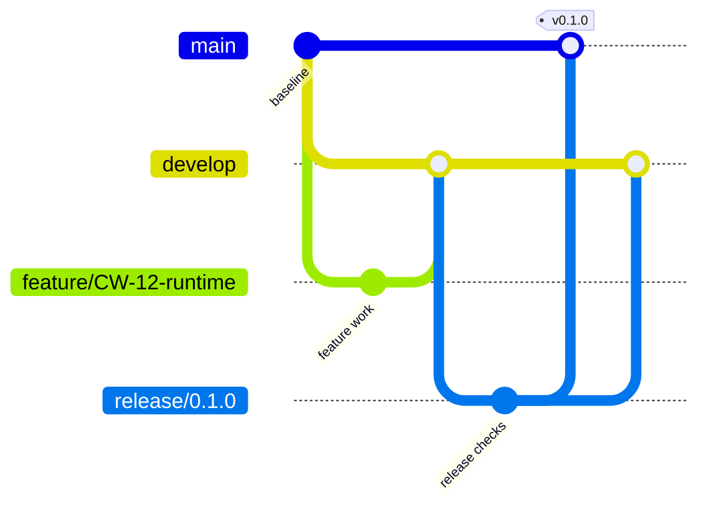

# CineWeave 贡献与 GitFlow 规范

本仓库严格使用 GitFlow。所有代码、配置、内容 Schema 和发行变更都通过对应分支流转；`main` 与 `develop` 是受保护分支。

## 1. 长期分支

| 分支 | 含义 | 允许进入的方式 |
|---|---|---|
| `main` | 已发布、可恢复的生产历史 | `release/*` 或 `hotfix/*` 经检查后合并 |
| `develop` | 下一批版本的集成状态 | `feature/*`、`bugfix/*` 和完成的 `release/*`/`hotfix/*` 回合 |

仓库第一次初始化时，先在 `main` 建立文档和工程基线，再从该提交创建 `develop`。这次引导提交是唯一例外；完成后所有开发均从短期分支开始。

## 2. 短期分支

| 类型 | 从哪里创建 | 合并到哪里 | 用途 |
|---|---|---|---|
| `feature/CW-<id>-<slug>` | `develop` | `develop` | 路线图功能、重构和成体系的文档变更 |
| `bugfix/CW-<id>-<slug>` | `develop` | `develop` | 尚未发布版本中的缺陷 |
| `research/CW-<map>-<slug>` | `develop` | 不合并 | Wayfinder Research Ticket 的一次性证据和上下文 |
| `release/<version>` | `develop` | `main`，随后回合 `develop` | 冻结、验证和发布一个版本 |
| `hotfix/<version>` | `main` | `main`，随后回合 `develop` | 已发布版本的紧急生产修复 |

`<slug>` 使用小写英文和连字符，例如 `feature/CW-12-story-runtime`。`<version>` 不带 `v`，例如 `release/0.1.0`；正式标签带 `v`，例如 `v0.1.0`。

`research/*` 是规划证据分支，不是产品开发分支。只有用户调用 `/wayfinder` 构图后，代理才能为新建的 Research Ticket 从最新 `develop` 创建、提交并推送对应分支；Issue 使用带标题的提交链接保存上下文。该分支不开 PR、不合并到 `develop` 或 `main`，也不承载功能实现。

## 3. 功能开发流程

1. 确认目标已存在于路线图或任务中，并且前置版本产物可用。
2. 从最新 `develop` 创建 `feature/*` 或 `bugfix/*`。
3. 在分支内完成实现、测试、迁移说明和必要文档。
4. 提交 Pull Request 到 `develop`，通过必需检查。
5. 使用非快进合并保留分支边界，合并后删除短期分支。

```powershell
git switch develop
git pull --ff-only origin develop
git switch -c feature/CW-12-story-runtime
```

一个功能分支只承担一个可验收目标。新需求改变原验收目标时，先更新路线图或拆出新的分支。

## 4. Release 流程

1. 目标版本的功能和迁移已进入 `develop`，验收门已满足。
2. 从 `develop` 创建 `release/<version>`，同时把路线图状态改为 Frozen。
3. Release 分支只接受版本号、CHANGELOG、发行说明、构建配置和阻断发布的修复。
4. CI 通过后，经 PR 非快进合并到 `main`。
5. 在 `main` 的发行提交上创建带说明的标签 `v<version>`。
6. 将 Release 分支非快进回合到 `develop`，确保发行修复不丢失，然后删除分支。
7. 将路线图状态改为 Released，并发布同一份经过验证的 ReleaseBundle。

```powershell
git switch develop
git switch -c release/0.1.0
# 完成冻结和验证后，通过 PR 合并
git switch main
git tag -a v0.1.0 -m "CineWeave v0.1.0"
```

标签、ReleaseManifest 和 ReleaseBundle 的版本必须一致。标签指向的提交保持不可变。

## 5. Hotfix 流程

1. 从最新生产标签所在的 `main` 创建 `hotfix/<version>`。
2. 只完成紧急修复及其回归测试，并更新 CHANGELOG。
3. 经 PR 合并到 `main`，创建新的补丁版本标签。
4. 把相同修复回合到 `develop`；存在活动 Release 分支时也同步进去。

Hotfix 不承载普通新功能。需要新产品能力时进入 `develop` 的下一功能版本。

## 6. 提交与合并

提交信息使用以下格式：

```text
<type>(<scope>): <summary>
```

常用类型：`feat`、`fix`、`docs`、`test`、`refactor`、`build`、`ci`、`chore`。示例：

```text
feat(runtime): add deterministic choice dispatch
docs(roadmap): insert media compatibility milestone
fix(save): preserve recorded AI decision on restore
```

- 每个提交保持可解释和可验证，不混入无关格式化或重构。
- 合并使用非快进策略，保留 GitFlow 分支边界。
- `main`、`develop` 禁止直接提交、强制推送和改写历史。
- 已发布标签禁止移动或复用。

## 7. Pull Request 验收门

所有 PR 至少满足：

- 目标分支符合 GitFlow。
- 相关自动测试、Schema 合约和构建检查通过。
- 行为变化具有测试；兼容变化具有迁移和回滚说明。
- UI 变化覆盖加载、错误、取消、离线和输入方式。
- AI/联网变化具有预算、安全、隐私、持久化和确定性回退。
- 外部或生成资产具有来源和授权记录。
- README、ROADMAP、GLOSSARY、CHANGELOG 只在相关事实变化时更新。

完成标准：PR 模板填写完整、必需检查全绿、评审意见已解决，并且目标版本的验收门仍然成立。

## 8. 分支保护

GitHub 上的 `main` 和 `develop` 应开启：

- 必须通过 Pull Request 合并。
- 必须通过状态检查，分支必须与目标分支保持最新。
- 禁止强制推送和删除分支。
- `main` 只接受 Release/Hotfix 流程，发布标签由 Release 负责人创建。
- 有第二名协作者后启用至少一名批准者；单人阶段仍保留 PR 和 CI 记录。


