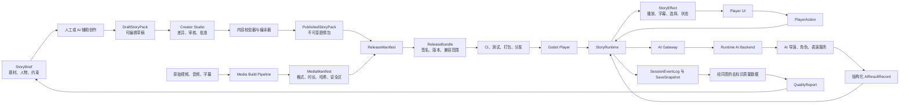
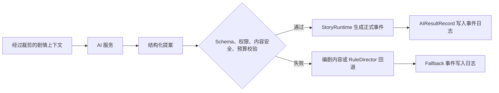

# 影织（CineWeave）

> 面向互动影视的 Godot 播放器、创作工具与受约束 AI 运行系统。

本文档是 CineWeave 当前的产品与版本规划基线。新功能必须能接入本文定义的内容生产、发布、运行和反馈闭环；不能只做一个无法被下一版本继承的演示。

## 文档导航

- [路线图变更制度](./docs/ROADMAP.md)：插入、调整、冻结和发布版本时的唯一规则来源。
- [贡献与 GitFlow 规范](./CONTRIBUTING.md)：所有代码、配置和发行工作的分支流程。
- [固定开发流程与技能命令](./docs/agents/development-workflow.md)：从需求访谈到实现、审查、PR、发行和复盘的执行入口。
- [变更日志](./CHANGELOG.md)：已经发布的能力及当前未发布变更，只追加、不改写历史。
- [领域术语表](./GLOSSARY.md)：剧情、运行时、AI 和发行概念的统一名称。
- [Godot Player 开发说明](./apps/player-godot/README.md)：运行 V0.1 Player 和无窗口冒烟检查。
- [Godot 引擎源码说明](./engine/README.md)：初始化、构建和升级固定的引擎 Fork。

当前详细路线图保留在本文档中；路线图的修改方式由 `docs/ROADMAP.md` 管理。仓库初始化完成后，所有实现严格通过 GitFlow 分支和合并流程进入 `develop` 与 `main`。

## 1. 产品目标

CineWeave 不是“把聊天框放到视频上”，也不是从头复制 Ren'Py。它要把 Ren'Py 成熟的叙事能力——节点、变量、条件、存档、回滚思维和创作工作流——转化为适合真人影像、Godot 播放以及 AI 扩展的结构。

第一阶段先证明一个最小闭环：

1. 创作者编写结构化剧情。
2. 工具校验剧情和媒体素材，并发布不可变版本。
3. Godot 播放器离线运行视频、字幕、选择和存档。
4. 玩家行为被记录为可复现事件。
5. AI 只能生成候选内容或结构化提案，经过校验后才可影响游戏。
6. 经玩家同意的匿名质量数据回到下一轮创作。

## 2. 已确定的产品原则

- **离线主线始终可玩。** 断网、模型超时或 AI 服务关闭时，使用编剧内容和规则回退。
- **AI 不直接控制游戏。** AI 不执行 GDScript、不创建任意资源路径、不直接修改存档或世界状态。
- **正式状态只有一个写入口。** `StoryRuntime` 校验 `PlayerAction`、AI 提案和剧情规则后，产生 `StoryEffect` 并更新状态。
- **同一存档必须可复现。** 已采用的 AI 结果进入事件日志；读档复用原结果，不重新生成另一个答案。
- **发布内容不可变。** 草稿可以编辑，发布后的 `PublishedStoryPack` 和 `ReleaseBundle` 只能创建新版本，不能原地改写。
- **客户端不保存模型密钥。** 运行时 AI 经后端代理完成鉴权、限流、计费、安全和缓存。
- **先完成体验，再扩大生成范围。** V1.0 的关键画面使用预录视频；实时生成语音、画面和动态支线放到 V2.0。
- **UI 是产品的一部分。** Godot 提供 `Control`、容器、主题、输入和视频组件，但不会自动产生适合影游的成品界面。
- **生成资产可追溯。** AI 生成或检索的文本、音频、图片和视频均记录来源、模型、提示版本、授权与人工审核状态。

## 3. 产品边界与系统组成

```text
apps/
  player-godot/          # 面向玩家的 Godot 客户端
  creator-studio/        # 编剧、导演、剪辑和审核使用的创作端
services/
  runtime-ai/            # 运行时 AI 后端；密钥、策略、限流和安全边界
packages/
  schemas/               # 各端共用的数据契约与版本定义
tools/
  content-compiler/      # 草稿校验、编译和发布
  media-pipeline/        # 转码、字幕、音频、哈希和媒体清单
content/
  samples/               # 可运行样片和自动测试内容
docs/                    # 架构决策、规范和制作指南
```

这些目录会随对应版本逐步创建，不要求在 V0.1 一次铺满空壳。

### 三个界面

| 界面 | 用户 | 主要任务 |
|---|---|---|
| Player UI | 玩家 | 观看、选择、输入、暂停、设置、存读档、理解联网与 AI 状态 |
| Creator Studio UI | 编剧/导演/剪辑/审核 | 编辑剧情图、管理素材、比较 AI 草稿、校验、审批和发布 |
| Developer UI | 开发/测试/运营 | 检查状态、事件、AI 决策、延迟、成本、兼容性和失败回退 |

## 4. 从创作到玩家的完整闭环



### 关键产物如何串联

| 产物 | 由谁产生 | 谁消费 | 不满足时怎么办 |
|---|---|---|---|
| `StoryBrief` | 主创 | 人工编剧、AI 辅助编剧 | 不进入草稿生成 |
| `DraftStoryPack` | 人工或 AI | Creator Studio、校验器 | 返回编辑，不得进入游戏发行 |
| `PublishedStoryPack` | 内容编译器 | Release Builder、StoryRuntime | 发布失败并给出可定位错误 |
| `MediaManifest` | 媒体流水线 | Release Builder、播放器 | 缺失或哈希不符则拒绝打包/启动 |
| `ReleaseManifest` | Release Builder | CI、更新器、播放器 | 兼容性不符时保留旧版本并提示 |
| `ReleaseBundle` | CI/发布系统 | Godot 客户端 | 校验失败时回滚到最近有效版本 |
| `AIResultRecord` | AI 后端 | StoryRuntime、事件日志、调试器 | 超时/越权/不合法时使用规则内容 |
| `SaveSnapshot` | StoryRuntime | 读档与迁移器 | 先迁移；不可迁移则阻止覆盖原存档 |
| `QualityReport` | 分析系统 | 下一轮策划和测试 | 不采集未授权的原始私人内容 |

## 5. 核心运行模型

### StoryRuntime 的最小职责

```text
open(published_story_pack)
start(entry_id) -> StoryEffect[]
dispatch(player_action) -> StoryEffect[]
capture() -> SaveSnapshot
restore(save_snapshot) -> StoryEffect[]
```

- Player UI 只提交 `PlayerAction`，只渲染 `StoryEffect`，不自行判断剧情真相。
- 视频播放完毕、点击选项、QTE、热点、自由文本和系统取消都属于不同类型的 `PlayerAction`。
- 播放片段、显示字幕、显示选项、改变可见状态、进入等待和展示错误都由 `StoryEffect` 表达。
- `WorldState`、`CharacterState`、`PlayerModel` 与 `SessionEventLog` 共同组成一次 `StorySession`。
- 所有分支判定都可在无 UI 环境中自动测试，避免逻辑被写死在 Godot 场景节点里。

### AI 的硬边界



AI 可做：生成草稿、从候选剧情中选择、提出对话意图、提出受限状态变化、生成表演参数和素材建议。

AI 不可做：直接写 `WorldState`、直接跳到未授权节点、访问完整隐私数据、执行代码、在客户端持有供应商密钥、绕过内容审核。

## 6. UI 设计基线

### Player UI

影像占据视觉中心，避免做成聊天应用。HUD 默认自动隐藏；字幕和选项根据 `MediaManifest` 中的画面安全区避开人物面部和关键信息。

```text
Main
├─ VideoStage
│  └─ VideoStreamPlayer
└─ UILayer
   ├─ SubtitleLayer
   ├─ ChoiceLayer
   ├─ InteractionLayer        # QTE、热点、自由输入
   ├─ PlaybackHUD
   ├─ PauseMenu
   ├─ SaveLoadPanel
   ├─ LoadingOverlay
   └─ ErrorAndFallbackOverlay
```

必须设计的状态不止正常播放，还包括：首次加载、缓冲、思考中、响应过慢、取消、断网、重试、内容安全替换、素材缺失、存档迁移失败和版本不兼容。

### Creator Studio UI

核心路径固定为：`Brief → 草稿 → 剧情图/时间线 → AI 差异比较 → 人工批准 → 校验 → 发布`。AI 生成结果永远先进入草稿区，不直接覆盖已批准内容。

### Developer UI

至少能查看：当前节点、状态差异、最近事件、命中条件、导演候选、AI 请求 ID、模型/提示版本、缓存命中、延迟、消耗、回退原因以及 Release/Save 兼容版本。

## 7. 重新设计后的版本路线图

版本号按数值段顺序递增：`V0.10` 在 `V0.9` 之后。每个版本必须通过验收门，下一版本才能把它视为稳定输入。这里的版本是规划里程碑；插入、改期、冻结和正式发布的处理方式统一遵循 [路线图变更制度](./docs/ROADMAP.md)。

### 阶段 A：最小影游与可靠运行底座

#### V0.1 — 可玩的离线种子

- **承接：** 产品名和本文档定义。
- **交付：** 独立 Godot 项目；3–5 分钟样片；片头 → 视频/占位素材 → 一次选择 → 两条结果 → 结尾；字幕、标题页、暂停、加载和错误遮罩；最小 `StoryPack`、`PlayerAction`、`StoryEffect`。
- **UI：** 建立颜色、字体、间距、动效时长等 Theme Token，不追求最终美术，但不使用默认丑陋控件直接发布。
- **验收门：** Windows 上离线启动；选择确实改变结局；缺失素材时有可理解错误；逻辑不写死在按钮回调中。
- **运行与导出：** [V0.1 Windows 离线验收与导出](./docs/release/V0.1-WINDOWS.md) 提供从干净环境到可校验验收包的固定命令；普通 Player/内容改动不重复编译未变化的 Godot Fork。

#### V0.2 — StoryPack 与共享数据契约

- **承接：** 将 V0.1 的最小数据正式化，不推翻样片。
- **交付：** `StoryBrief`、节点、角色、世界变量、条件、媒体引用、本地化键和版本 ID 的 Schema；`DraftStoryPack` 与 `PublishedStoryPack` 分离。
- **验收门：** V0.1 样片迁移后行为一致；无效 ID、悬空分支和错误字段可被自动定位。

#### V0.3 — 确定性 StoryRuntime

- **承接：** 只读取 V0.2 的发布剧情包。
- **交付：** UI 无关的运行时；`clip`、`choice`、`end`、`jump`、`set`、`condition`、`call/return`；PlayerAction → StoryEffect 单一通道。
- **UI：** Player UI 改为纯消费 StoryEffect；Developer UI 可查看节点和 Effect。
- **验收门：** 同一输入序列得到同一节点、状态和 Effect；核心分支可在无窗口测试中运行。

#### V0.4 — 内容校验、编译与发布

- **承接：** V0.2 Schema 与 V0.3 运行规则。
- **交付：** Draft → Validate → Compile → Published 流水线；图连通性、条件类型、媒体引用、本地化、不可达结局和循环风险报告。
- **UI：** Developer UI 展示可点击定位的错误和警告。
- **验收门：** 运行时只接受编译后的包；错误草稿不能伪装成发布内容。

#### V0.5 — 世界状态、事件日志与可复现会话

- **承接：** V0.3 的动作/效果模型与 V0.4 的发布包。
- **交付：** `WorldState`、`CharacterState`、`PlayerModel`、追加式 `SessionEventLog`、状态差异和确定性随机种子。
- **UI：** Developer UI 增加状态和事件检查器。
- **验收门：** 从初始状态重放日志可还原相同会话；越权字段更新被拒绝并记录。

#### V0.6 — 存档、检查点与迁移

- **承接：** V0.5 可复现会话。
- **交付：** 自动/手动存档、检查点、存档版本、迁移器、原子写入、损坏检测；为未来 AI 结果预留持久化字段。
- **UI：** 存读档、覆盖确认、迁移失败和恢复提示。
- **验收门：** 强制退出后可从检查点恢复；旧测试存档升级不被静默覆盖；重复读档结果一致。

#### V0.7 — 媒体构建流水线

- **承接：** V0.4 的内容媒体引用。
- **交付：** 视频/音频转码、响度与格式检查、字幕校验、缩略图、哈希、预加载分组和画面安全区，生成 `MediaManifest`。
- **验收门：** 内容引用与产物一一对应；篡改、缺失或不支持的素材在发布前失败。

#### V0.8 — ReleaseBundle、兼容性与 CI

- **承接：** `PublishedStoryPack` + `MediaManifest`。
- **交付：** `ReleaseManifest`、不可变 `ReleaseBundle`、内容/Schema/媒体/存档兼容矩阵、自动构建、冒烟测试、校验和与回滚入口。
- **验收门：** 客户端启动前完成兼容检查；失败时保留最近有效版本；构建可重复。

### 阶段 B：完整离线创作与玩家体验

#### V0.9 — 影院化 Player UI

- **承接：** V0.8 可发布的样片。
- **交付：** 响应式布局、字幕样式、自动隐藏 HUD、设置、音量、键鼠/手柄焦点、转场和预加载反馈。
- **验收门：** 16:9 与常见窗口尺寸无溢出；字幕和选项不遮挡配置的安全区；截图回归测试生效。

#### V0.10 — 高级互动与无障碍基线

- **承接：** V0.3 动作模型和 V0.9 UI。
- **交付：** 限时选择、QTE、画面热点、跳过/快进策略、字幕字号/背景、色觉与运动减弱选项、完整手柄操作。
- **验收门：** 所有互动均能转化为 PlayerAction；仅键盘或仅手柄可完成样片；超时和取消有确定结果。

#### V0.11 — Creator Studio 基础版

- **承接：** V0.2 Schema 与 V0.4 编译器。
- **交付：** 项目浏览、剧情图、节点表单、媒体绑定、校验面板、预览、草稿/发布权限边界。
- **验收门：** 非程序人员无需手改 JSON 即可修改 V0.1 样片并发布新 Bundle。

#### V0.12 — 创作审核与协作记录

- **承接：** V0.11 编辑器。
- **交付：** 差异比较、评论、批准/拒绝、变更来源、素材权利字段、发布说明和基础冲突处理。
- **验收门：** 每个发布字段可追踪到人工或工具来源；未批准变更不可进入发布包。

#### V0.13 — 确定性离线竖切样片

- **承接：** 阶段 A/B 全部能力。
- **交付：** 5–10 分钟、至少三次有意义选择、两个结局的参考样片；真实媒体、完整 UI、存档和发布流程。
- **验收门：** 自动分支测试全绿；目标机器流畅；断网完整可玩；形成后续 AI 版本的体验对照组。

### 阶段 C：AI 辅助创作

#### V0.14 — AIGateway 与任务契约

- **承接：** V0.2 Schema、V0.12 审核流程。
- **交付：** 统一 AI 任务/结果 Schema、假实现、一个真实供应商适配器、请求 ID、模型/提示版本、超时和结构化错误；密钥仅用于本地开发或服务端。
- **UI：** Developer UI 可查看脱敏请求、响应、耗时和校验结果。
- **验收门：** 更换供应商不改变领域数据；非结构化或不合法响应不能进入草稿。

#### V0.15 — AI 辅助编剧

- **承接：** V0.14 网关和 V0.12 人工审批。
- **交付：** 从 StoryBrief 生成节点/分支草稿、字幕、角色小传；一致性、敏感词、结构和预算校验。
- **UI：** Creator Studio 展示生成中、取消、逐字段差异、接受/拒绝和重新生成。
- **验收门：** AI 结果只能形成 DraftStoryPack；关闭 AI 后创作与发布仍可使用。

#### V0.16 — 媒体智能与资产来源

- **承接：** V0.7 媒体流水线和 V0.12 来源记录。
- **交付：** 素材自动标签、字幕校对、检索和剪辑建议；生成资产的模型、提示、时间、授权、审核和替换链。
- **UI：** Creator Studio 媒体搜索、建议比较和权利告警。
- **验收门：** 建议不会自动改原素材；来源或授权缺失的资产不能进入候选发行包。

### 阶段 D：受约束的运行时 AI

#### V0.17 — Runtime AI Backend

- **承接：** V0.14 AIGateway 和 V0.8 发布身份。
- **交付：** 服务端鉴权、会话、供应商适配、密钥管理、流式响应、速率限制、缓存、请求追踪和客户端版本策略。
- **验收门：** 客户端包中无供应商密钥；断网/超时/限流均返回机器可判定的回退原因。

#### V0.18 — AI 剧情导演

- **承接：** V0.5 状态/日志、V0.17 后端、V0.13 对照样片。
- **交付：** 编剧先提供候选剧情；AI 根据授权上下文排序或选择；`RuleDirector` 始终可回退；生成 `DirectorDecision`。
- **UI：** Developer UI 展示候选、理由标签、信心、采用项和回退项，不向玩家泄露剧透。
- **验收门：** AI 不能创造未发布节点；相同存档读取已保存决策；关闭 AI 可继续主线。

#### V0.19 — 上下文、角色记忆与玩家模型

- **承接：** V0.18 导演选择。
- **交付：** Context Assembler、事实表、角色知情边界、近期事件、摘要、好感与情绪、最小化玩家偏好；明确过期和冲突规则。
- **UI：** Developer UI 提供“为何知道/为何选择”的记忆检查器和隐私删除入口。
- **验收门：** 角色不会读取无权知道的事实；上下文有大小预算；删除玩家数据后不再进入新请求。

#### V0.20 — AI 角色短时对话

- **承接：** V0.19 受控上下文和 V0.17 后端。
- **交付：** 仅指定场景允许自由输入；角色回复、意图分类和 `ProposedEvent`；轮数/时长/主题限制；预写对话回退。
- **UI：** 自由输入、思考中、响应过慢、取消、重试、离线和安全替换状态；视觉仍服务于电影画面。
- **验收门：** 回复不能直接更新状态；越界提案被拒绝；敏感输入有安全策略；断网可退出对话并继续剧情。

#### V0.21 — AI 表演计划、配音与字幕辅助

- **承接：** V0.20 角色文本和 V0.16 资产来源。
- **交付：** `PerformancePlan`、情绪/语速/停顿标签、受控 TTS、字幕对齐与缓存；无授权声线禁用。
- **UI：** 播放器显示生成/缓冲状态并允许切回文字或预录音频；创作端可逐句审核。
- **验收门：** 首包延迟和总成本在预算内；生成音频持久化并可复现；声线授权可追溯。

### 阶段 E：治理、反馈与完整样片

#### V0.22 — AI 治理与故障降级

- **承接：** V0.17–V0.21 的所有 AI 调用。
- **交付：** 单会话/单任务预算、缓存、重试、熔断、并发控制、隐私同意、内容审核、模型/提示策略版本、审计和离线回退矩阵。
- **UI：** 玩家可查看/撤回联网与数据同意；运营端查看成本、失败率和熔断状态。
- **验收门：** 模拟慢网、断网、供应商故障、超预算和危险输出时，主线均不会卡死。

#### V0.23 — 可观测性与质量反馈闭环

- **承接：** V0.5 事件、V0.8 Release ID 和 V0.22 同意策略。
- **交付：** 崩溃、剧情漏斗、分支覆盖、AI 延迟/成本/回退/安全指标；去标识、保留期和 `QualityReport`。
- **验收门：** 未同意时不上传可选分析；报告能定位到发布版本而非个人；QualityReport 可形成下一轮 StoryBrief。

#### V0.24 — AI 竖切样片

- **承接：** V0.13 确定性样片与 V0.15–V0.23 AI 能力。
- **交付：** 20–30 分钟完整样片；至少一个导演选择场景、一个短时角色对话和一个表演辅助场景；确定性 A/B 版本。
- **验收门：** 验证成本、首响/全响延迟、角色一致性、断网、内容安全、存读档复现和玩家理解度；未达标能力可被单独关闭。

### 阶段 F：发布

#### V0.25 — Alpha：内容完整

- **承接：** V0.24 通过验证的能力集合。
- **交付：** 全章节可从头到尾完成；最终视觉主题、章节选择、结局/回顾、正式本地化和无障碍覆盖；AI 总开关。
- **验收门：** 不再缺主线内容；所有结局可达；AI 关闭和离线模式都能通关。

#### V0.26 — Beta：稳定与兼容

- **承接：** 内容完整 Alpha。
- **交付：** 内容锁定；旧存档迁移、弱网/离线、性能、显存/磁盘、不同 DPI、安装/卸载、更新/回滚和安全测试。
- **验收门：** 无阻断级缺陷；升级失败可恢复；目标硬件达到帧率、加载和磁盘预算。

#### V0.27 — Release Candidate

- **承接：** 稳定 Beta。
- **交付：** 签名 Bundle 和安装包、全量回归、隐私说明、授权/来源清单、第三方许可证、商店素材与应急开关演练。
- **验收门：** 候选包冻结；只接受阻断发布的修复；法律、隐私、安全和运营检查签字完成。

#### V1.0 — Windows 首发

- **承接：** 通过 V0.27 的同一候选包。
- **交付：** 经过约束的 AI 导演、少量指定 AI 角色场景、完整离线主线、更新/回滚和运营监控。
- **验收门：** 发布后可按功能单独关闭 AI，不影响购买者继续游玩和读取已有存档。

### V1.x 与 V2.0

| 版本 | 承接与目标 | 核心交付 |
|---|---|---|
| V1.1 | 基于 V1.0 真实质量数据优化 | 延迟、成本、缓存、提示和难点调优，不破坏存档 |
| V1.2 | 扩展已验证的发行模型 | 新章节/DLC、本地化包、内容包依赖与增量下载 |
| V1.3 | 扩展 Creator Studio | 可视化剧情图、时间线、批量媒体管理和更完整预览 |
| V1.4 | 降低单一云供应商依赖 | 本地模型、更多供应商和能力路由 |
| V1.5 | 从内部工具走向创作者平台 | 第三方签名 StoryPack、沙箱、模板和发布审核 |
| V2.0 | 在 V1.x 可靠数据和治理上扩大生成范围 | 实时语音、画面、动态支线与直播观众共同影响剧情；所有生成仍经过预算、安全、来源和状态校验 |

## 8. 跨版本不可退化的质量要求

- **测试累积：** StoryRuntime 单元测试、Schema 合约测试、剧情图测试、Bundle 完整性、存档迁移、UI 截图、后端契约、故障注入、内容安全、成本预算和全量回归只增不减。
- **Schema 演进：** 版本化并提供显式迁移；禁止静默改变已有字段语义。
- **存档保护：** 迁移前备份，写入使用原子替换；AI 结果随事件持久化，读档不重新生成。
- **离线回退：** 每个联网功能在设计时必须指定 authored/rule fallback；没有回退就不能合入主线。
- **发布完整性：** 剧情、媒体、AI 策略和存档兼容范围都进入 ReleaseManifest。
- **安全和隐私：** 最少数据、明确同意、可撤回、可删除、日志脱敏、客户端无供应商密钥。
- **资产权利：** 所有外部或生成素材具有来源、授权、使用范围和审核记录。
- **可关闭性：** AI 导演、角色、配音、分析等能力使用独立开关，故障时不拖垮整个产品。

## 9. V0.1 的建议制作清单

V0.1 只做能证明玩法闭环的内容。《零点回声》正式样片固定为 5 段 1280×720 Ogg Theora/Vorbis 媒体、逐段简体中文字幕、1 个选择点和 2 个结局；登车路线约 3:55，离开路线约 3:45。媒体、字幕、字体、来源和授权均随仓库记录并自动校验。

1. 创建 `apps/player-godot`，设定入口场景、分辨率和输入映射。
2. 建立最小 JSON StoryPack 与三种节点：`clip`、`choice`、`end`。
3. 实现最小 StoryRuntime 和动作/效果边界。
4. 建立 VideoStage、SubtitleLayer、ChoiceLayer、PauseMenu 和错误遮罩。
5. 使用“影院极简”非默认 Theme 和 Noto Sans SC，跑通两条正式分支。
6. 添加无窗口分支测试、正式媒体契约、启动冒烟测试和 README 中的运行说明。

V0.1 明确不做：联网 AI、可视化编辑器、复杂存档、实时生成视频、多人互动和商店发行。它们已经有后续承接版本，不需要挤进第一个里程碑。

## 10. 术语

代码、剧情数据、文档和 AI 提示统一使用 [GLOSSARY.md](./GLOSSARY.md) 中的领域术语。新增同义词前先更新术语表，避免同一概念在不同模块中漂移。

## 11. 开发治理

- 规划范围变化先更新路线图及其变更记录，再开始实现。
- 实现工作从 `develop` 创建 `feature/*` 或 `bugfix/*` 分支，通过检查后合并回 `develop`。
- 正式发行通过 `release/*` 进入 `main` 并创建语义化版本标签；线上紧急修复通过 `hotfix/*` 同时回合 `main` 与 `develop`。
- `main` 和 `develop` 都不直接开发，完整规则以 [CONTRIBUTING.md](./CONTRIBUTING.md) 为准。

## 12. 许可证与内容权利边界

- CineWeave 程序代码和未另行声明的项目开发文档按根目录 [MIT License](./LICENSE) 提供。
- Player 捆绑的 Noto Sans SC 是第三方字体，按 SIL Open Font License 1.1 分发，详见 [THIRD_PARTY_NOTICES.md](./THIRD_PARTY_NOTICES.md)。
- 《零点回声》的正式剧情、字幕、程序化画面和合成环境音为 © 2026 Dong90，保留所有权利，不随根目录 MIT License 授权；完整边界和素材清单见 [ASSET_SOURCE.md](./content/samples/zero-echo/ASSET_SOURCE.md)。
